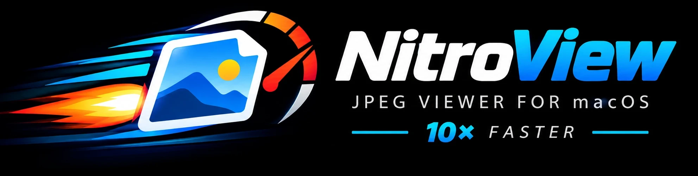

<p align="center"></p>

# jpeg-nitro

[English](README.md) | **Magyar**

A **NitroView** nagyon gyors képnéző **macOS-re, Windowsra és Linuxra**. Fotókat, szkenneléseket,
Photoshop-fájlokat, nyers (raw) képeket és vektoros rajzokat nyit meg, és saját dekóderekre épül,
amelyek minden képet több CPU-magon dekódolnak: egy 24 megapixeles JPEG egy asztali Intel
processzoron kb. 11 ms alatt nyílik meg, tízszer gyorsabban, mint a rendszer dekóderével, így egy
fotósorozat olyan gyorsan lapozható, ahogy a billentyűt nyomod. Az SVG- és CorelDRAW-rajzok
bármekkora nagyításban élesek.

Felhasználói felülete gyakorlatilag nincs: egy ablak a képpel, lapozni és nagyítani billentyűkkel
és az egérrel lehet.

| platform | néző |
|---|---|
| macOS 12-től, Intel és Apple Silicon | `nitroview.app` (Cocoa + Metal, universal) |
| Windows 10-től, Direct3D 11-gyel | `nitroview.exe` (egyetlen önálló fájl) |
| Linux, GNOME | `nitroview-gnome` (GTK 4 + libadwaita), Flatpakként is |
| SDL3 + OpenGL (Linuxon és macOS-en kipróbálva, x86 és ARM) | `nitroview-sdl` (egyetlen önálló fájl) |

Mind a négy ugyanúgy viselkedik: ugyanazok a billentyűk, egér- és érintőpados gesztusok, nagyítás
és ablakkezelés, teljes képernyő, diavetítés és előtöltés. Az eltéréseket a
[Platformok](#platformok) rész sorolja fel.

## Letöltés és telepítés

Kész buildek a GitHubon: [Releases](https://github.com/gereoffy/jpeg-nitro/releases).

**macOS:** nyisd meg a dmg-t, és húzd a `nitroview.app`-ot az Applications mappába. A dmg
hitelesített (notarized), ezért Gatekeeper-figyelmeztetés nélkül nyílik. Hogy ez legyen az
alapértelmezett képnéző: a Finderben egy képen Információ → Megnyitás ezzel → nitroview → Az
összes módosítása. Képeket vagy mappát a Dock-ikonra vagy az ablakra is rá lehet húzni, vagy a ⌘O-val
megnyitni; a futó néző átveszi az új fájlokat.

**Windows:** csomagold ki a `nitroview-windows-x64.zip`-et bárhová, telepíteni nem kell semmit. A
`nitroview.exe --register` felajánlja az összes képtípushoz az Intézőben (az aktuális felhasználónak,
rendszergazdai jog nélkül), és megnyitja a Beállítások → Alapértelmezett alkalmazások oldalt, ahol ki
kell választani (az alapértelmezést a Windowsban csak a felhasználó választhatja); a `--unregister`
visszavonja. Ha fut, a megnyitott fájlok a futó ablakban jelennek meg (`-n`: új ablakban). A
`_noavx2` zip az AVX2 nélküli processzorokhoz való (AMD FX, 2013 előtti Intel). A HEIC-fotókhoz a
Microsoft „HEVC Video Extensions” bővítménye kell a Store-ból.

**Linux, GNOME:** `flatpak install --user nitroview-gnome.flatpak`. A HEIC-fotókhoz az
`org.freedesktop.Platform.codecs-extra` kiterjesztés kell a Flathubról.

**Linux SDL3-mal:** csomagold ki a `nitroview-linux-x64.tar.gz`-t (vagy az `-arm64`-et Asahi
Linuxon Apple M1 / M2-n és Raspberry Pi 4 / 5-ön): egyetlen fájl bármilyen asztalhoz, Waylandre és
X11-re, amihez csak a glibc 2.35 vagy újabb kell. A `nitroview-sdl --register` az aktuális
felhasználónak felveszi az asztal alkalmazásai közé („Megnyitás ezzel” a fájlkezelőben), az
`--unregister` eltávolítja. Ez a néző HEIC-fájlokat nem nyit meg (lásd [HEIC](#heic)).

Fordítás saját kezűleg, a make-opciók és a dekóderek használata saját programból:
[BUILDING.md](BUILDING.md) (angolul).

## Használat

```
nitroview [-f] [-s ms] [-j n] kep.jpg ... | konyvtar/
```

Adj neki fájlokat, egy mappát vagy egyetlen fájlt: ez utóbbinál a lapozás a mappája többi képén halad
végig, a fájlkezelő sorrendjében (a mappát csak az első lapozáskor olvassa be, így a macOS csak akkor
kér hozzáférési engedélyt a mappához, ha tényleg lapozol). A `-f` teljes képernyőn indít, a `-s ms`
diavetítést, a `-j n` a dekóder szálainak számát korlátozza. Paraméterek nélkül (vagy `-h`-val) a
program kiírja az összes kapcsolót; a windowsos és az SDL-es néző fájl nélkül indítva
fájlválasztó ablakot nyit.

### Billentyűk

| billentyű | funkció |
|---|---|
| PgDn / Space | következő kép |
| PgUp / Backspace | előző kép |
| Home / End | első / utolsó kép |
| [ / ] | többoldalas CorelDRAW-rajz előző / következő oldala (címsor: [page 2/5]) |
| + / − | nagyítás / kicsinyítés (√2-es lépések, pontosan megáll 100%-nál és az illesztett méretnél) |
| 0 | illesztés a képernyőhöz: a kis képeket is felnagyítja (lapozáskor is megmarad, a W-ig) |
| 1 | eredeti méret: egy képpixel = egy képernyőpixel |
| 2 … 8 | 200% … 800%, pixelpontosan: egy képpixel = N×N képernyőpixel |
| ← → ↑ ↓ | a nagyított kép mozgatása (Shifttel fél képernyőnyi lépés) |
| W | vissza a kép saját méretére (kis képek 100%-on), az ablak újra követi a képek méretét |
| E / Shift + E | DNG nyers képek: világosabb / sötétebb 1/3 EV-vel (±3 EV-ig; lapozáskor megmarad, a címsorban látszik) |
| Del (Macen ⌘ + Backspace is) | törlés: a fájl a mellette lévő (rejtett) `.delete` mappába kerül, jön a következő kép; semmi nem vész el |
| U / Ctrl + Z (Macen ⌘ Z) | az utolsó törlés visszavonása: a fájl visszakerül a helyére |
| F / Enter | teljes képernyő be/ki |
| P | diavetítés szüneteltetése / folytatása |
| Esc / Q | kilépés (Esc teljes képernyőn: vissza ablakba) |

### Egér és érintőpad

| gesztus | funkció |
|---|---|
| húzás | a nagyított kép mozgatása |
| görgő | nagyítás a kurzor alatti pont körül (kattanásonként √2-es lépés; érintőpadon folyamatos, csippentés is) |
| dupla kattintás | illesztett → 100% a kattintott ponton; újra → vissza illesztettre |
| jobb kattintás / Shift + jobb kattintás | következő / előző kép |
| Ctrl + görgő | előző / következő kép (érintőpadon 40 képpontonként egy kép) |
| egér oldalgombok (vissza / előre) | előző / következő kép |

### Az ablak és a nagyítás

- Az ablak a kép méretét veszi fel: pontosan 100%-on, ha elfér a képernyőn, különben a kép
  oldalarányával akkorára, amekkora elfér (fekete sávok nélkül). Nagyításkor az ablak a képpel együtt
  nő a képernyő méretéig, kicsinyítéskor visszazsugorodik; a 0 visszaállítja.
- Lapozáskor az ablak követi az egyes képek méretét, a közepét megtartva. Ha az ablakot magad
  méretezed át (szélhúzás, zöld gomb, ablakrendezés), megtartja azt a méretet; a W visszaállítja a
  kép méretére, és újra bekapcsolja az automatikus méretezést.
- **A nagyítás és a pozíció lapozáskor megmarad**: egy sorozatban ránagyíthatsz egy részletre (mondjuk
  a szemekre), és végiglapozva megkeresheted a legélesebb képet. Nagyítás közben az ablak, a nagyítás
  és a pozíció változatlan marad.
- Az egész számú nagyítások (200%, 300%, 400%, …, a görgővel vagy a +/− gombokkal elérve is) a
  képpontokat pontos négyzetekként mutatják; a többi szint simán interpolált.
- A görgős nagyítás a kurzor alatti pontot helyben tartja; amíg a kép valamelyik irányban keskenyebb
  az ablaknál, abban az irányban középen marad, amíg ki nem tölti az ablakot.
- A címsor mutatja a fájlnevet, a méretet, a nagyítást és a dekódolási időt. Az EXIF-orientációt
  figyelembe veszi. A lapozás az első és az utolsó képnél megáll.

### Diavetítés

`-s <ms>` (vagy `--slideshow <ms>`): a következő kép akkor jön, amikor az aktuális már `ms`
ezredmásodperce a képernyőn van (`-s 2000` klasszikus diavetítés, `-s 40` ~25 kép/s). Ha egy kép
betöltése tovább tart, kivárja, így egy kép sem marad ki. Az utolsó képnél megáll; a P szünetelteti;
a lapozó gombok közben is működnek, és onnan folytatja. Az időzítés a monitor frissítéséhez igazodik
(60 Hz-en ±8 ms).

### Tippek

- Ha Macen a Ctrl + görgő az egész képernyőt nagyítja, a macOS Kisegítő lehetőségek nagyítása van a
  Ctrl + görgetés gesztusra állítva (Rendszerbeállítások → Kisegítő lehetőségek → Nagyítás). Ha a
  csippentés nem csinál semmit, a gesztus ki van kapcsolva (Rendszerbeállítások → Trackpad → Görgetés
  és nagyítás → Nagyítás vagy kicsinyítés).
- A nagyító billentyűk karakter szerint működnek, így bármilyen kiosztáson és a numerikus
  billentyűzeten is mennek.
- A törlés csak a mellette lévő rejtett `.delete` mappába teszi a fájlt; az U visszavonja, a mappa
  pedig bármikor kézzel üríthető (vagy visszaállítható).

### Platformok

| | macOS | Windows | GNOME | SDL (Linux) |
|---|---|---|---|---|
| fájlok / mappa megnyitása | ⌘O, ráhúzás az ikonra vagy az ablakra | O / Shift + O, ráhúzás | Megnyitás-ablak, ráhúzás | O / Shift + O |
| alapértelmezett néző | Finder: Az összes módosítása | `--register` | a Flatpak, vagy `make gnome-register` | `--register` |
| HEIC | igen (VideoToolbox) | a HEVC Video Extensions bővítménnyel | a codecs-extra kiterjesztéssel | nem |
| színkezelés | az ICC-profilokat figyelembe veszi | sRGB | sRGB | sRGB |
| nem saját formátumok | Apple ImageIO | WIC | a GTK betöltői | stb_image (csak GIF, BMP, interlaced PNG, sérült / CMYK JPEG) |
| ablak | követi a képet | követi a képet | lapozáskor megtartja a méretét (Wayland), a 0 maximalizálja | követi a képet |

A GNOME-os néző Czirok Ferenc munkája. A windowsos érintőpados gesztusok nincsenek kipróbálva.

## Támogatott formátumok

| formátum | mit nyit meg | korlátok |
|---|---|---|
| **JPEG** | baseline és progresszív, bármilyen chroma-mintavételezés, szürkeárnyalatos; bitre egyezik a libjpeg-turbóval | CMYK, aritmetikai kódolás, sérült vagy csonka fájlok: ezeket a rendszer dekódere nyitja meg |
| **PNG** | minden nem interlaced PNG: 8 / 16 bites, palettás, 1 / 2 / 4 bites, átlátszósági kulcs, alfa (fekete háttéren) | interlaced PNG (ritka): a rendszer dekódere nyitja meg |
| **HEIC** | iPhone-fotók (8 bites 4:2:0 HEVC, a csempézettek is), a rendszer HEVC-dekóderével: lásd [HEIC](#heic) | |
| **AVIF** | 8 / 10 / 12 bit, 4:2:0 / 4:2:2 / 4:4:4 / szürke, alfa, rácsok, vágás / forgatás / tükrözés (az AV1-et a [dav1d](https://code.videolan.org/videolan/dav1d) bontja ki) | a réteges csempékből álló rácsot nem dekódolja (két Apple-tesztfájl), a rendszer dekóderére hagyja |
| **WebP** | veszteséges (VP8) | veszteségmentes és átlátszó WebP: a rendszer dekódere nyitja meg |
| **TIFF** | tömörítetlen, PackBits, LZW, Deflate, CCITT G3 / G4; 1–16 bites szürke, palettás, RGB, CMYK, alfa; csíkok vagy csempék, chunky vagy planar | JPEG-tömörítésű TIFF: a rendszer dekódere nyitja meg |
| **PSD / PSB** | 8 bites RGB és szürkeárnyalatos fájlok összefésült (kompozit) képe, mind a négy tömörítéssel; az összefésült átlátszóság fekete háttéren | más színmódok és bitmélységek: a rendszer dekódere nyitja meg; a „Maximize Compatibility” nélkül mentett fájlokban nincs összefésült kép, ezek fehéren jelennek meg (mint minden nézőben) |
| **DNG** | a nyers adatból teljes felbontásban előhívva (Bayer, veszteségmentes JPEG vagy tömörítetlen): gyors betekintés, hogy mi van a képen, nem raw-konverter; E / Shift + E az expozícióhoz | a zajszűrés, az objektívkorrekció és a többi DNG-opkód nem érvényesül |
| **fényképezőgépes raw** (CR2, NEF, NRW, ARW, RAF) | a gép által a fájlba tett teljes méretű JPEG (a fájlnak csak ez a része olvasódik be) | |
| **SVG** | alakzatok, útvonalak, színátmenetek, vágás, maszk, minta, `<style>` stíluslap, szöveg a rendszer betűtípusaival, beágyazott képek | a szűrők kimaradnak (árnyék, elmosás); a `<foreignObject>`-beli HTML (draw.io) nem jelenik meg; az SVG-betűtípusok és a csak szimbólumokat tartalmazó sprite-fájlok nem rajzolnak semmit |
| **CorelDRAW** (CDR 5 – X6, CMX) | rajzok, szöveg (hiányzó font helyett hasonlóval), beágyazott bitképek, többoldalas dokumentumok ([ / ]), a rejtett rétegek kimaradnak, mint a CorelDRAW-ban; a megjelenített terület a rajz befoglaló kerete, nem a lap | a nyílhegyek és a Corel saját vektoros és bitképes mintakitöltései kimaradnak |
| **minden más** (GIF, BMP, …) | az operációs rendszer dekóderével (ImageIO, WIC, a GTK betöltői; az SDL-es nézőben az stb_image) | |

A vektoros rajzokat először egészben rajzolja ki, így a lapozás, az illesztés és a kicsinyítés
ugyanúgy megy, mint a fotóknál. Ennél jobban felnagyítva a látható részt képernyő-felbontásban újra
kirajzolja, amint a nagyítás vagy a pozíció egy pillanatra megáll, így a csippentés folyamatos marad,
és a kép a megállás után élesedik ki.

### HEIC

A HEIC-fotók HEVC (H.265) képek, a HEVC-re pedig licencet igénylő szabadalmak vonatkoznak: az
operációs rendszerek dekóderei ezzel együtt jönnek, a saját megvalósításunk nem. Ezért az általunk
terjesztett binárisok a HEIC-et csak a rendszer dekóderével bontják ki: macOS-en a VideoToolbox-szal
(a nitroheic párhuzamosan adja át neki egy iPhone-fotó csempéit), Windowson a WIC-kel (a Microsoft
HEVC Video Extensions bővítményének telepítve kell lennie), a GNOME-os nézőben a GTK betöltőivel (a
Flatpaknak a codecs-extra kiterjesztés kell); az SDL-es néző ilyenkor egyáltalán nem mutat
HEIC-fájlokat. A saját HEVC-dekóderünk, a nitrohevc (csak intra, a H.265 szabvány alapján írva; a
deblocking és az SAO szűrő kimarad, fotókon ez nem látszik) csak a saját kezűleg, `make NITROHEVC=1`-gyel
fordított buildben van benne ([BUILDING.md](BUILDING.md#macos)), saját használatra: a szabadalmak
kérdése ekkor a tiéd.

### Sérült fájlok

Ha valamelyik saját dekóder hibát észlel (érvénytelen Huffman-kód, idő előtt véget érő adat, rossz
számú restart marker, …), feladja, és a néző a rendszer dekóderére vált, ami megmutatja, ami
menthető (például egy félig letöltött fájl felső részét). Ha semmi nem tudja dekódolni (ismeretlen
formátum, sérült fejléc, üres fájl), a címsorban `CANNOT DECODE` áll, és a lapozás megy tovább.

### Színkezelés

macOS-en a beágyazott ICC-profilokat minden formátumnál figyelembe veszi (Display P3 az iPhone-okról
és a Mac-es képernyőképekből, Adobe RGB a szkennelésekből, …); a profil nélküli képeket sRGB-nek
tekinti, és széles színtartományú kijelzőn a széles színtartomány is megmarad. A windowsos, a
GNOME-os és az SDL-es néző minden képet sRGB-ként mutat (a profilt figyelmen kívül hagyja).

## Miért gyors

Minden formátumot a saját dekóderünk bont ki, amely egyetlen képet is több CPU-magon dekódol, még
az eredendően soros tömörítésű formátumoknál is: a JPEG és a DNG Huffman-folyamát és a PNG
deflate-folyamát spekulatívan, párhuzamos darabokban fejti vissza. Az inverz DCT Intelen AVX2-t,
ARM-on NEON-t használ, a színkonverzió és a skálázás a GPU-n fut, és a néző a következő képeket
előre dekódolja, amíg az aktuálisat nézed.

| formátum | tesztkép | libnitro | referencia-dekóder |
|---|---|---|---|
| JPEG | 24 MP-es fotó | **11 ms** | libjpeg-turbo 107 ms (1 szálon) |
| progresszív JPEG | 24 MP-es fotó | **79 ms** | libjpeg-turbo 336 ms |
| PNG | 38 valódi PNG, átlag | **43 ms** | ImageIO 318 ms, Wuffs 171 ms |
| PSD | 24 MP, RLE | **5 ms** | ImageIO 170 ms |
| HEIC | 12 MP-es iPhone-fotó | **33 ms** | ImageIO 200 ms |
| DNG | 20 MP-es raw | **8 ms** | ImageIO 210–510 ms |
| WebP | 42 MP | **100 ms** | ImageIO 360 ms |
| TIFF | 13 MP-es 16 bites szken (73 MB) | **2 ms** | ImageIO 31 ms |
| AVIF | 41 webes AVIF, átlag | **10 ms** | ImageIO 32 ms |
| SVG | 38 MB-os rajz | **0,53 s** | WebKit 1,4 s, CoreSVG 2,4 s |
| CorelDRAW | 17,7 MB-os, csak vektoros terv | **1,8 s** | libcdr `cdr2xhtml` 5,4 s (csak SVG-vé alakítás) |

Asztali Intel i9-en mérve. Egy 2020-as M1-es MacBook Airen egy 24 MP-es JPEG ~30 ms alatt
dekódolódik, háromszor gyorsabban, mint ugyanazon a gépen az Apple hardveres JPEG-dekódere. Egy
mappányi 24 MP-es fotó a kijelző frissítési sebességével, 60 kép/s-mal játszható le, így egy timelapse
teljes felbontásban, valós időben nézhető. Hogy az egyes dekóderek hogyan csinálják, és az összes
mérés: [BENCHMARKING.md](BENCHMARKING.md) (angolul).

## Fordítás és a könyvtár

[BUILDING.md](BUILDING.md) (angolul): a nézők fordítása minden platformon, a make-opciók, és a
`libnitro`, a dekóderek egyetlen könyvtárként a saját programodhoz (egy százsoros példaprogrammal,
amely bármilyen általa dekódolt képet BMP-vé alakít).

## Licenc

MIT, lásd [LICENSE](LICENSE). Az opcionális külső összetevőknek (libjpeg-turbo, dav1d, SDL3, lunasvg
és plutovg, libcdr és librevenge, lcms2, boost, mimalloc, stb_image, Wuffs) saját licencük van:
[BUILDING.md](BUILDING.md#third-party-licences). Ez a szoftver részben az Independent JPEG Group
munkáján alapul.
