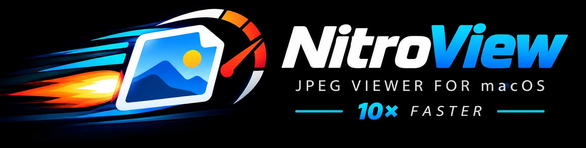

<p align="center"></p>

# jpeg-nitro

**English** | [Magyar](README.hu.md)

**NitroView** is a very fast image viewer for **macOS, Windows and Linux**. It opens photos, scans,
Photoshop files, raw images, vector drawings and PDFs, and it is built on its own decoders, which decode
every image on multiple CPU cores: a 24-megapixel JPEG opens in about 11 ms on a desktop Intel CPU, ten
times faster than the system's decoder, so a photo series pages as fast as you press the key. Vector
drawings are rendered sharp at any zoom level.

There is no user interface to speak of: a window with the picture in it, use keys and the mouse to
page and zoom.

| platform                                               | viewer                                                    |
| ------------------------------------------------------ | --------------------------------------------------------- |
| macOS 12+, Intel and Apple Silicon                     | `nitroview.app` (Cocoa + Metal, universal)                |
| Windows 10+ with Direct3D 11+                          | `nitroview.exe` (one self-contained file)                 |
| Linux with GNOME                                       | `nitroview-gnome` (GTK 4 + libadwaita), also as a Flatpak |
| SDL3 + OpenGL (tested on Linux and macOS, x86 and ARM) | `nitroview-sdl` (one self-contained file)                 |

All four behave the same: the same keys, mouse and trackpad gestures, zoom and window behavior, full
screen, slideshow and prefetching. The differences are listed under [Platform notes](#platform-notes).

## Download and install

Ready-made builds are available on GitHub: [Releases](https://github.com/gereoffy/jpeg-nitro/releases).

**macOS:** open the dmg and drag `nitroview.app` to Applications. The dmg is notarized, so it opens
without a Gatekeeper warning. To make it the default viewer: in the Finder, Get Info on an image →
Open with → nitroview → Change All. Images or folders can also be dropped on its Dock icon or its
window, or opened with ⌘O; a running viewer takes the new files.

**Windows:** unzip `nitroview-windows-x64.zip` anywhere, there is nothing to install.
`nitroview.exe --register` offers it for all image types in Explorer (current user, no admin rights)
and opens Settings → Default apps, where you pick it (Windows lets only the user choose the default);
`--unregister` removes it again. Files opened while it runs appear in the running window (`-n`: a new
one). The `_noavx2` zip is for CPUs without AVX2 (AMD FX, Intel before 2013). HEIC photos need
Microsoft's "HEVC Video Extensions" from the Store.

**Linux with GNOME:** `flatpak install --user nitroview-gnome.flatpak`. HEIC photos need the
`org.freedesktop.Platform.codecs-extra` extension from Flathub.

**Linux with SDL3:** unpack `nitroview-linux-x64.tar.gz` (or `-arm64` for Asahi Linux on an
Apple M1 / M2 and the Raspberry Pi 4 / 5): one file for any desktop, Wayland or X11, which needs
only glibc 2.35 or newer.
`nitroview-sdl --register` adds it to the desktop's applications for the current user ("Open with"
in the file manager), `--unregister` removes it. This viewer opens no HEIC files (see
[HEIC](#heic)).

Building it yourself, the make options, and using the decoders in your own program:
[BUILDING.md](BUILDING.md).

## Usage

```
nitroview [-f] [-s ms] [-j n] image.jpg ... | directory/
```

Give it files, a folder, or a single file: paging then moves through the other images of its
folder, in the file manager's order (the folder is listed only on the first paging key, so macOS
asks for folder access only if you actually page). `-f` starts in full screen, `-s ms` a slideshow,
`-j n` limits the threads for decoding and drawing. Run without arguments (or with `-h`) for all options; the Windows and
SDL viewers open a file dialog when started without files.

### Keys

| key                           | action                                                                                                         |
| ----------------------------- | -------------------------------------------------------------------------------------------------------------- |
| PgDn / Space                  | next image                                                                                                     |
| PgUp / Backspace              | previous image                                                                                                 |
| Home / End                    | first / last image                                                                                             |
| [ / ]                         | previous / next page of a multi-page drawing: CDR, Visio, DXF / DWG, draw.io, PDF (title: [page 2/5])          |
| + / −                         | zoom in / out (√2 steps, stops exactly at 100% and at fit)                                                     |
| 0                             | fit to the screen: small images are enlarged too (stays on while paging, until W)                              |
| 1                             | actual size: one image pixel = one screen pixel                                                                |
| 2 … 8                         | 200% … 800%, pixel-exact: one image pixel = N×N screen pixels                                                  |
| ← → ↑ ↓                       | move a zoomed image (Shift: half a screen per step)                                                            |
| W                             | back to the image's own size (small images at 100%), the window follows image sizes again                      |
| E / Shift + E                 | DNG: 1/3 EV brighter / darker (up to ±3 EV); vector drawings: change background color; kept while paging       |
| Del (Mac: also ⌘ + Backspace) | delete: the file is moved to the `.delete` folder next to it (hidden), the next image follows; nothing is lost |
| U / Ctrl + Z (Mac: ⌘ Z)       | undo the last delete: the file goes back to its place                                                          |
| F / Enter                     | toggle full screen                                                                                             |
| P                             | pause / resume the slideshow                                                                                   |
| Esc / Q                       | quit (Esc in full screen: back to a window)                                                                    |

### Mouse and trackpad

| gesture                             | action                                                                                      |
| ----------------------------------- | ------------------------------------------------------------------------------------------- |
| drag                                | move a zoomed image                                                                         |
| scroll wheel                        | zoom around the point under the cursor (one √2 step per notch; trackpad: smooth, pinch too) |
| double click                        | fit → 100% at the clicked point; again → back to fit                                        |
| right click / Shift + right click   | next / previous image                                                                       |
| Ctrl + scroll wheel                 | previous / next image (trackpad: one image per 40 px)                                       |
| mouse side buttons (back / forward) | previous / next image                                                                       |

### The window and the zoom

- The window takes the image's size: exactly 100% if it fits the screen, otherwise as large as fits
  with the image's aspect ratio (no black bars). Zooming in grows the window with the image up to the
  screen size, zooming out shrinks it back; 0 restores it.
- When paging, the window follows each image's size, keeping its center. After you resize the window
  yourself (edge drag, green button, tiling) it keeps that size; W brings it back to the image size
  and turns the automatic sizing back on.
- **Zoom and position are kept when paging**: in a burst or series you can zoom into a detail (the
  eyes, say) and page through to find the sharpest shot. While zoomed in, the window, zoom and
  position stay as they are.
- Integer zoom levels (200%, 300%, 400%, …, also when reached with the wheel or +/−) show the pixels
  as exact square blocks; other levels are smoothly interpolated.
- Wheel zoom keeps the point under the cursor in place; while the image is narrower than the window
  along an axis it stays centered there until it fills the window.
- The title shows the file name, size, zoom and decode time. EXIF orientation is honored. Paging
  stops at the first and last image.

### Slideshow

`-s <ms>` (or `--slideshow <ms>`): the next image comes when the current one has been on screen for
`ms` milliseconds (`-s 2000` is a classic slideshow, `-s 40` is ~25 images/s). If an image takes
longer to load, it waits, so no image is skipped. It stops at the last image; P pauses; the paging
keys keep working and the slideshow continues from there. Timing follows the display refresh (±8 ms
at 60 Hz).

### Tips

- If Ctrl + scroll zooms the whole screen on a Mac, macOS Accessibility zoom is set to use Ctrl with
  the scroll gesture (System Settings → Accessibility → Zoom). If pinching does nothing, the gesture
  is turned off (System Settings → Trackpad → Scroll & Zoom → Zoom in or out).
- The zoom keys work by character, so they work on any keyboard layout and on the numeric keypad.
- Delete only moves the file into the hidden `.delete` folder next to it; U undoes it, and the folder
  can be emptied (or restored) by hand at any time.

### Platform notes

|                       | macOS                          | Windows                        | GNOME                                              | SDL (Linux)                                                    |
| --------------------- | ------------------------------ | ------------------------------ | -------------------------------------------------- | -------------------------------------------------------------- |
| open files / a folder | ⌘O, drop on the icon or window | O / Shift + O, drag & drop     | Open dialog, drag & drop                           | O / Shift + O                                                  |
| default viewer        | Finder: Change All             | `--register`                   | the Flatpak, or `make gnome-register`              | `--register`                                                   |
| HEIC                  | yes (VideoToolbox)             | with the HEVC Video Extensions | with codecs-extra                                  | no                                                             |
| color management     | ICC profiles honored          | sRGB                           | sRGB                                               | sRGB                                                             |
| formats not ours      | Apple ImageIO                  | WIC                            | GTK's loaders                                      | stb_image (GIF, BMP, interlaced PNG, damaged / CMYK JPEG only) |
| window                | follows the image              | follows the image              | keeps its size while paging (Wayland), 0 maximizes | follows the image                                              |

The GNOME viewer was contributed by Ferenc Czirok. Windows touchpad gestures are untested.

## Supported formats

| format                                   | what opens                                                                                                                                                                                                           | limitations                                                                                                                        |
| ---------------------------------------- | -------------------------------------------------------------------------------------------------------------------------------------------------------------------------------------------------------------------- | ------------------------------------------------------------------------------------------------------------------------------------ |
| **JPEG**                                 | baseline and progressive, any chroma subsampling, grayscale                                                                                                                            | CMYK, arithmetic coding, damaged or cut-off files: the system's decoder opens them                                                                                    |
| **PNG**                                  | all non-interlaced PNGs: 8 / 16-bit, palette, 1 / 2 / 4-bit, transparency key, alpha (shown over black)                                                                                                              | interlaced PNGs (rare): the system's decoder opens them                                                                                                               |
| **HEIC**                                 | iPhone photos (8-bit 4:2:0 HEVC, also the tiled ones), with the system's HEVC decoder: see [HEIC](#heic)                                                                                                             |                                                                                                                                      |
| **AVIF**                                 | 8 / 10 / 12-bit, 4:2:0 / 4:2:2 / 4:4:4 / gray, alpha, grids, crop / rotation / mirroring (AV1 by [dav1d](https://code.videolan.org/videolan/dav1d))                                                                  | a grid of layered tiles (two Apple test files) is not decoded, it is left to the system's decoder                                                                                       |
| **WebP**                                 | lossy (VP8)                                                                                                                                                                                                          | lossless and transparent WebP: the system's decoder opens them                                                                                                        |
| **TIFF**                                 | uncompressed, PackBits, LZW, Deflate, CCITT G3 / G4; 1–16-bit gray, palette, RGB, CMYK, alpha; strips or tiles, chunky or planar                                                                                     | JPEG-compressed TIFF: the system's decoder opens it                                                                                                                 |
| **PSD / PSB**                            | the merged (composite) image of 8-bit RGB and grayscale files, all four compressions; merged transparency shown over black                                                                                           | other color modes and depths: the system's decoder opens them; files saved without "Maximize Compatibility" have no merged image and show white (as in every viewer) |
| **DNG**                                  | developed at full resolution from the raw data (Bayer, lossless JPEG or uncompressed): a quick look at what is in the picture, not a raw converter; E / Shift+E for the exposure control                             | noise reduction, lens corrections and the other DNG opcodes are not applied                                                                            |
| **camera raw** (CR2, NEF, NRW, ARW, RAF) | the full-size JPEG the camera stored in the file (only that part of the file is read)                                                                                                                                |                                                                                                                                      |
| **SVG**                                  | shapes, paths, gradients, clipping, masks, patterns, `<style>` sheets, text with the system's fonts, embedded images                                                                                                 | filters are left out (drop shadows, blurs); HTML in `<foreignObject>` (draw.io) is not drawn; SVG fonts and symbol-only sprites draw nothing   |
| **CorelDRAW** (CDR 5 – X6, CMX)          | drawings, text (with font matching), embedded bitmaps, multi-page documents; the shown area is the drawing's bounding box, not the page | pattern fills are not rotated or skewed |
| **Visio** (VSD / VSDX; stencils and templates) | shapes, text, embedded images, multi-page documents | hatch fills are not drawn yet; text fields show their stored value |
| **draw.io** (.drawio, .dio)              | shapes, connectors routed as draw.io routes them, labels (bold, italic, line breaks), multi-page diagrams | the stencil libraries' icons and pictures show as their frame; other HTML formatting in labels is dropped |
| **WMF / EMF** (Windows metafiles)        | the GDI drawing, text with the system's fonts, DIB bitmaps with masks, gradient fills, clipping, world transforms | EMF+ records (GDI+ drawings) are not read: a dual file shows its GDI part, an EMF+-only one is empty; raster operations other than copy and mask pairs are approximated |
| **DXF** (AutoCAD R12–2018), **DWG** (R13–R2018, not R2007) | the model space and each layout's sheet with its viewports, as separate pages; DWG: see [DWG](#dwg) | multileaders, multilines, 3D solids, referenced images, external references (xrefs) and the objects of AutoCAD Architecture / Mechanical are not drawn; line weights are ignored; binary DXF does not open |
| **PDF**                                  | pages, embedded fonts, images (JPG,CCITT,JBIG2), CMYK through an ICC profile, annotations, encrypted files without a password; using [pdfparse3](https://github.com/gereoffy/pdfparse3) | JPEG 2000 (JPX) images not shown; shadings, tiling patterns, blend modes and the soft masks of groups are ignored |
| **everything else** (GIF, BMP, …)        | through the operating system's decoder (ImageIO, WIC, GTK's loaders; stb_image in the SDL viewer)                                                                                                                    |                                                                                                                                      |

Vector drawings are rendered first in full, so paging, fitting and zooming out work as for photos.
Zoomed in beyond that, the visible part is rendered again at screen resolution once the zoom or
position has been still for a moment, so pinching stays smooth and the picture sharpens when it
stops.

### HEIC

HEIC photos are HEVC (H.265) pictures, and HEVC is covered by patents that need a license: the
operating systems' decoders come with one, our own implementation does not. So the binaries we
distribute decode HEIC only with the system's decoder: VideoToolbox on macOS (nitroheic hands it an
iPhone photo's tiles in parallel), WIC on Windows (Microsoft's HEVC Video Extensions must be
installed), GTK's loaders in the GNOME viewer (the Flatpak needs the codecs-extra extension); the
SDL viewer then shows no HEIC files at all. Our own HEVC decoder, nitrohevc (intra-only, written
from the H.265 specification; it leaves out the deblocking and SAO filters, which cannot be seen on
photos), is only in a build you make yourself with `make NITROHEVC=1` ([BUILDING.md](BUILDING.md#macos)),
for your own use: the patents are then your concern.

### DWG

DWG drawings open with our own reader, nitrodwg: it reads the objects as ACadSharp (C#, MIT) does,
checked against the Open Design Alliance's specification of the format, and hands them to nitrodxf
as the same drawing's DXF would. LibreDWG is not used (it is GPL); its `dwg2dxf` was the reference
in testing. Of 8341 drawings 4848 look the same pixel for pixel; most of the rest differ where
LibreDWG loses something: it gives every anonymous block the same name (dimensions and old hatches
then all show one block), names a block and its inserts differently, drops polyline widths,
accented letters and some colors, and writes true colors that a DXF reader takes wrongly. R2007
and R12 or older drawings do not open (convert those to DXF).

On a white background the colors of DXF and DWG drawings are a fifth darker (white turns light
gray), so light lines remain visible; the foreground color (black on white) is not changed. Pages
with the same content are shown only once.

### Damaged files

When one of our decoders detects an error (an invalid Huffman code, data ending early, a wrong
number of restart markers, …) it gives up, and the viewer falls back to the system's decoder, which
shows whatever is recoverable (the top part of a half-downloaded file, say). If nothing can decode
it (unknown format, broken header, empty file), the title shows `CANNOT DECODE` and paging continues.

### Color management

On macOS embedded ICC profiles are honored for every format (Display P3 from iPhones and Mac
screenshots, Adobe RGB scans, …); images without a profile are treated as sRGB, and wide-gamut
colors are kept on a wide-gamut display. The Windows, GNOME and SDL viewers show every image as
sRGB (the profile is ignored).

## Why it is fast

Every format is decoded by our own decoder, which decodes a single image on several CPU cores, even for
formats whose compression is sequential by design: JPEG's and DNG's huffman stream and PNG's deflate stream
are decoded speculatively in parallel pieces. The inverse DCT uses AVX2 on Intel and NEON on ARM, the
color conversion and the scaling run on the GPU, and the viewer decodes the next images ahead while
you look at the current one.

| format           | test image                | libnitro   | reference decoder                                |
| ---------------- | ------------------------- | ---------- | ------------------------------------------------ |
| JPEG             | 24 MP photo               | **11 ms**  | libjpeg-turbo 107 ms (1 thread)                  |
| progressive JPEG | 24 MP photo               | **79 ms**  | libjpeg-turbo 336 ms                             |
| PNG              | 38 real PNGs, average     | **43 ms**  | ImageIO 318 ms, Wuffs 171 ms                     |
| PSD              | 24 MP, RLE                | **5 ms**   | ImageIO 170 ms                                   |
| HEIC             | 12 MP iPhone photo        | **33 ms**  | ImageIO 200 ms                                   |
| DNG              | 20 MP raw                 | **8 ms**   | ImageIO 210–510 ms                               |
| WebP             | 42 MP                     | **100 ms** | ImageIO 360 ms                                   |
| TIFF             | 13 MP 16-bit scan (73 MB) | **2 ms**   | ImageIO 31 ms                                    |
| AVIF             | 41 web AVIFs, average     | **10 ms**  | ImageIO 32 ms                                    |
| SVG              | 38 MB drawing             | **0.53 s** | WebKit 1.4 s, CoreSVG 2.4 s                      |
| CorelDRAW        | 17.7 MB all-vector plan   | **1.8 s**  | libcdr's `cdr2xhtml` 5.4 s (SVG conversion only) |
| DXF              | 7.5 MB floor plan         | **17 ms**  | ezdxf 8.7 s                                      |
| DWG              | 1 MB floor plan           | **20 ms**  |                                                  |
| Visio            | 15 MB, 6 pages, pictures  | **87 ms**  |                                                  |
| PDF              | large CAD plans, average  | **119 ms** | macOS (Preview's renderer) 170 ms                |

Measured on an Intel i9 desktop. On a 2020 M1 MacBook Air a 24 MP JPEG decodes in ~30 ms, three
times faster than Apple's hardware JPEG decoder on the same machine. A folder of 24 MP photos plays
back at the display's refresh rate, 60 images/s, so a timelapse can be watched at full resolution in
real time. How each decoder does it, and all the measurements: [BENCHMARKING.md](BENCHMARKING.md).

## Building and the library

[BUILDING.md](BUILDING.md): building the viewers on every platform, the make options, and
`libnitro`, the decoders as one library for your own program (with a hundred-line example that
converts any image it decodes to a BMP), and `libnitrovec`, the vector drawings the same way (with
`nitrodraw`, a page of any drawing to a BMP). [FILES.md](FILES.md): what each source file is.

## License

MIT, see [LICENSE](LICENSE), with the code taken from others and the licenses of the optional
dependencies. This software is based in part on the work of the Independent JPEG Group.
